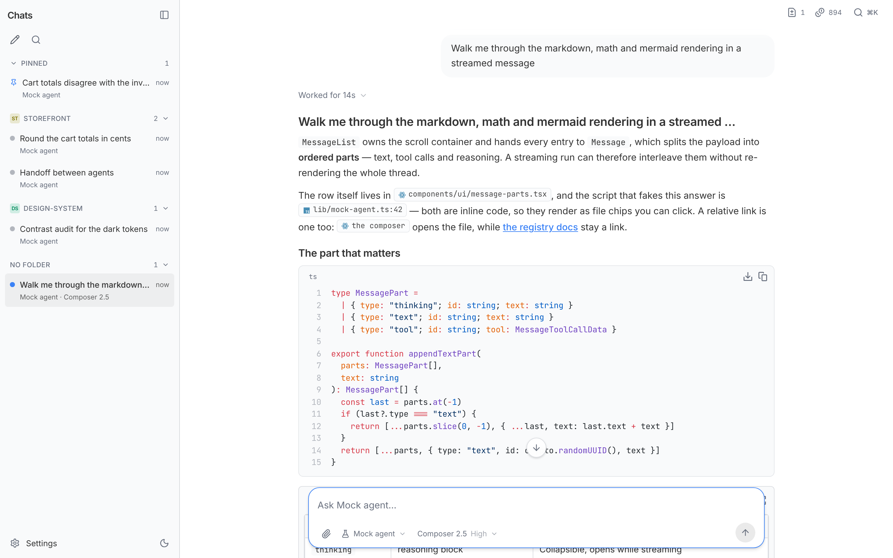
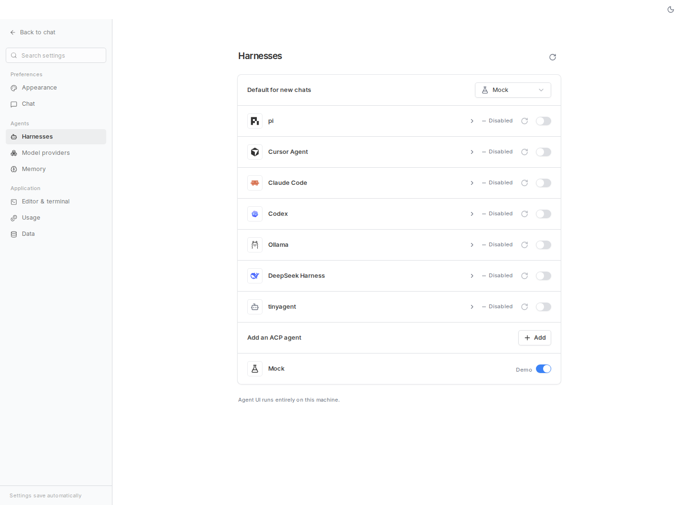
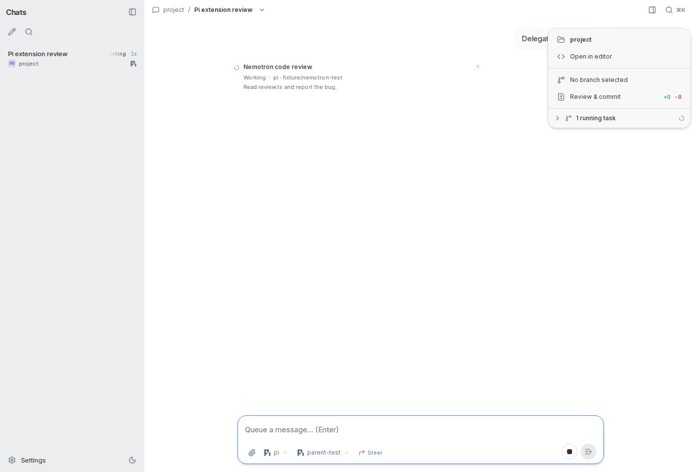
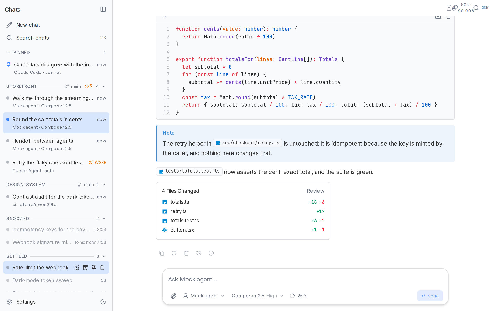
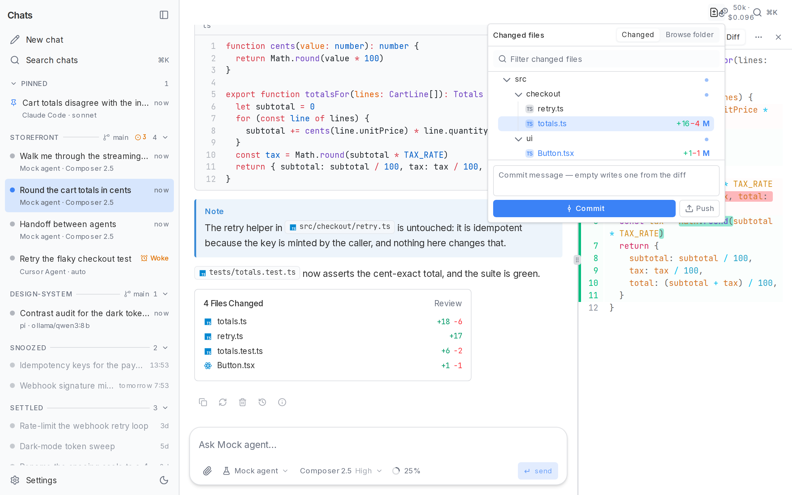
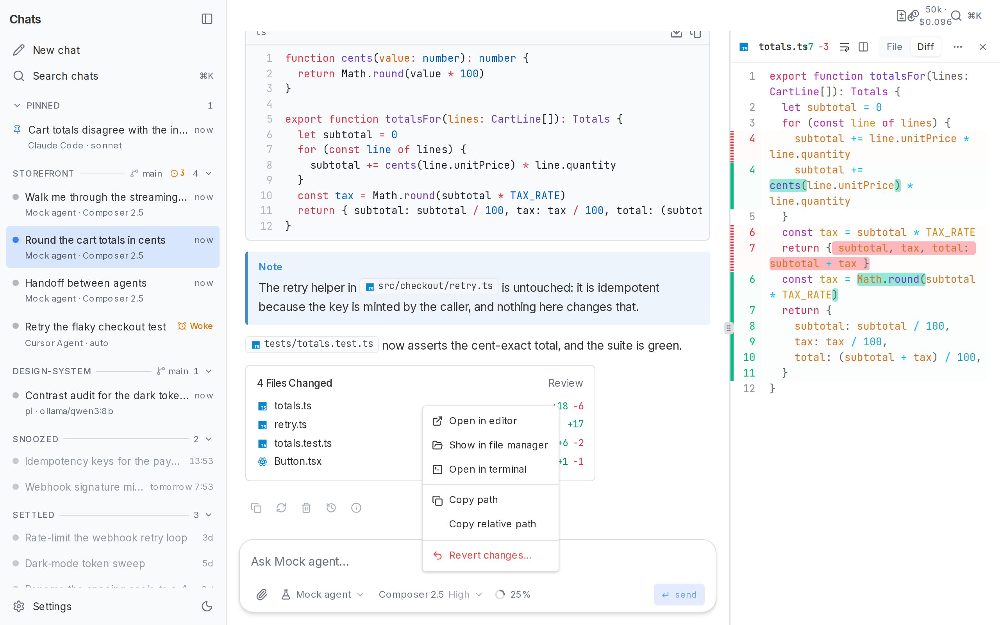
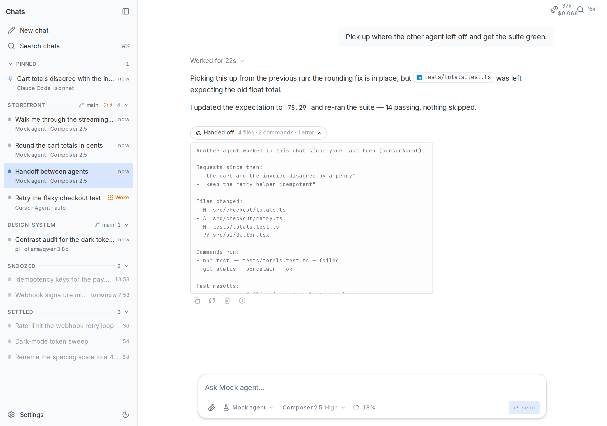
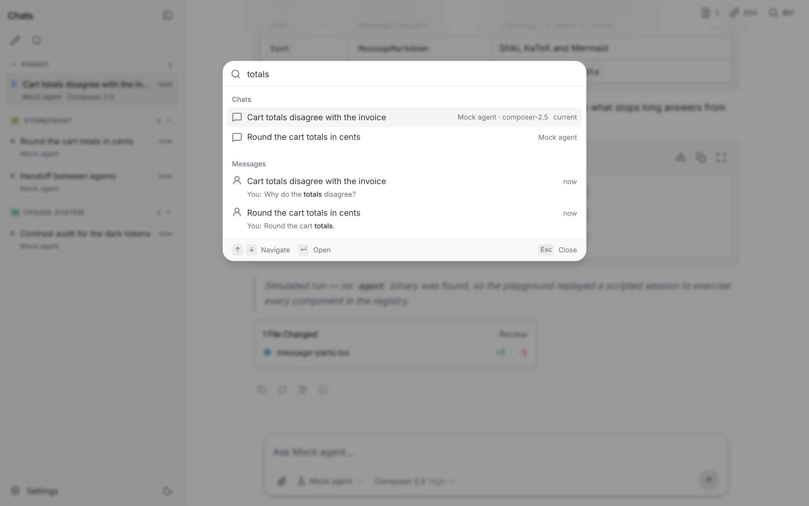
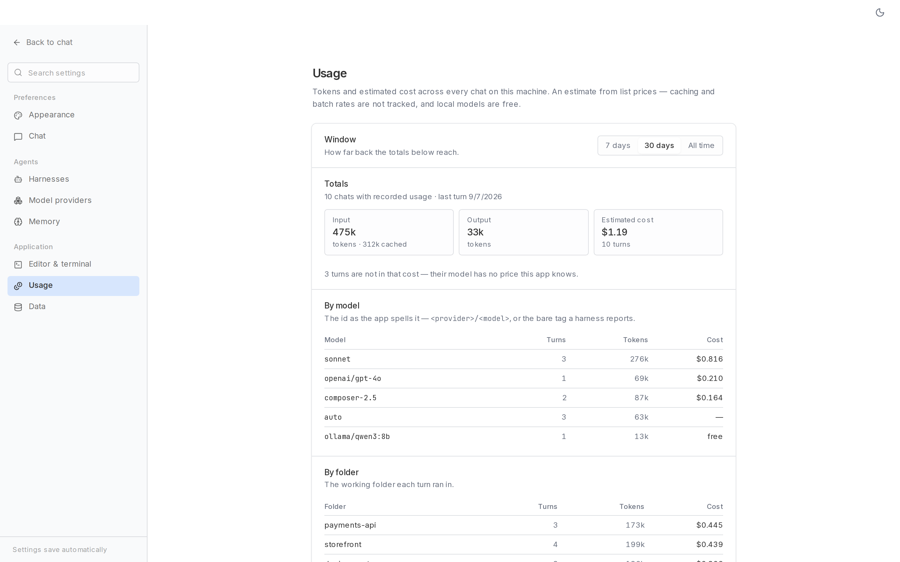

# Agent UI

A local-first desktop and web client for AI coding agents. Agent UI gives
Cursor Agent, Claude Code, Codex, pi, Ollama, OpenAI-compatible models, and
[Agent Client Protocol](https://agentclientprotocol.com/) servers one
conversation interface built with Next.js, React, TypeScript, and Tauri.

[](https://github.com/miskibin/agent-ui/actions/workflows/ci.yml)
[](https://github.com/miskibin/agent-ui/actions/workflows/desktop.yml)

[Website](https://miskibin.github.io/agent-ui/) ·
[Download for Windows](https://github.com/miskibin/agent-ui/releases/latest) ·
[Chat Components](https://github.com/miskibin/chat-components)



## Why Agent UI

- **One UI, multiple agents.** Switch providers inside a chat. Each backend
  keeps its own resumable session, and an explicit handoff summarizes what it
  missed.
- **Background runs.** A turn keeps streaming when you open another chat.
  Returning shows the same in-flight run and transcript.
- **Agent-native output.** Reasoning, tool lifecycles, structured questions,
  markdown, code, diagrams, artifacts, token usage, and failures are
  first-class parts of the conversation. A plan the agent writes is rendered as
  a card with a Build button that starts the work. Unanswered questions stay above the
  composer while you scroll; submitting or skipping restores their summary in
  the transcript.
- **Workspace-aware files.** Give each chat a folder, inspect changed files and
  diffs beside the transcript, then open them in your editor or terminal. The
  header opens a tree of everything the chat changed, and a lazy browser for the
  rest of the folder; binary files say so instead of pretending to be text.
- **A worktree per chat.** Start a chat in a git worktree of its own — its own
  branch, in the app's own directory — so two agents work on one repository
  without touching one file. Branches are named after the chat, and removing the
  last chat that used one offers to remove the worktree with it.
- **Commit, push, and see what is serving.** Stage what the chat changed and
  commit it with a message written from the diff in the repository's own style,
  push the branch (upstream set on the first push), and open the dev servers the
  work left running on localhost.
- **Per-turn checkpoints.** Every turn in a git folder is bracketed by a
  worktree snapshot, so one action puts the files back the way they were before
  it ran. Switchable in Settings → Chat.
- **Queue or steer.** Enter queues a follow-up while the agent runs; Ctrl/⌘+Enter
  (or Ctrl/⌘-click on the queue button) stops the current turn and sends a
  correction, preserving its transcript. Queued messages offer **Send now**;
  Stop pauses the queue until you explicitly continue.
- **Composer that remembers.** ArrowUp walks back through the prompts already
  sent in the chat, drafts survive a chat switch, and answers render GitHub
  alerts and clickable `path.ts:42` chips.
- **Skills and harness commands.** `$name` offers the skills installed on this
  machine and sends each harness the invocation it actually understands; `/`
  lists the CLI's own commands beside the app's. The context meter offers
  "Compact context" where the harness has it, and suggests compacting before you
  resume a long conversation you left hours ago.
- **Search what was said.** ⌘K matches chats by title *and* by the words in
  their messages, then opens the chat at the matching turn.
- **Import your CLI history.** Bring the conversations Claude Code and Codex
  have already had into the app, preserving their original resumable sessions.
- **Hold to quit.** ⌘Q while a turn is running is held, not confirmed: nothing
  is in the way when nothing is running, and a stray press cannot kill an agent
  mid-edit.
- **A sidebar you can size.** Drag its edge (or resize it from the keyboard),
  group chats by working folder, pin and delete from the row itself.
- **Local persistence.** Chats, settings, provider sessions, and optional memory
  live under `~/.agent-ui`.
- **Visible usage.** See tokens and estimated cost per chat, model, and working
  folder over 7 days, 30 days, or all time — cache reads and writes counted at
  their own rates, and unpriced turns reported rather than folded in.
- **Desktop or browser.** The same Next.js application runs in a frameless
  Tauri shell or as a standalone local server.

## Backends

| Backend | Connection | Tools | Resume |
| --- | --- | :-: | :-: |
| Cursor Agent | local `agent` CLI | Yes | Yes |
| Claude Code | local `claude` CLI | Yes | Yes |
| Codex | local `codex app-server` over stdio | Yes | Yes |
| pi | local `pi` CLI with Ollama or hosted models | Yes | Yes |
| ACP agents | configured command over JSON-RPC, natively or inside WSL; includes DeepSeek Harness and tinyagent profiles | Yes | Yes |
| Ollama | native streaming chat API | No | Transcript replay |
| Chat | any configured OpenAI-compatible `/chat/completions` endpoint | No | Transcript replay |
| Mock | local scripted backend for development and tests | Yes | No |

Provider availability is detected at runtime. Configure binaries, endpoints,
API keys, models, workspaces, and supported permission modes in Settings.
Provider rows show their icon and status; expand a row for setup commands and
configuration. Refresh one provider or the whole list to recheck availability
and reload models. Pending settings changes are saved before the check.



### Pi and subagents

Install Pi with `npm i -g @earendil-works/pi-coding-agent`, then select it in
Agent UI. The app automatically installs and loads its question and subagent
extensions; no separate `pi install` or shell command is needed. Existing Pi
sessions receive the tools on their next turn too.

Pi can discover models, start child tasks, check progress, wait, send follow-ups
and cancel work. Children appear as live chats under their parent, with cards
that follow the actual running, completed, failed or cancelled state. For a code
review using a local model, keep **Pi** as the harness and select the model from
**Ollama**; the standalone Ollama harness is chat-only. Child chats do not get
recursive delegation tools.



### ACP agents and tinyagent

An ACP agent's process is kept between turns (and closed after 15 idle
minutes), so an agent that holds its sessions in memory — like
[tinyagent](https://github.com/vicgupta/tinyagent)'s `--acp` mode — remembers
the conversation. When the process is gone and the agent cannot
`session/load`, the fresh session is briefed with the transcript. Streamed
text, tool calls with their files and diffs, plans, context usage, the agent's
own `/` commands and session modes, and client-side terminals are all
supported.

tinyagent ships configured: install it, and its models are yours — Ollama and
every entry under Model providers, LiteLLM and other OpenAI-compatible
endpoints included — or "tinyagent default" for its own config. The chat's
permission picker sets `--read-only`. If it is installed inside WSL, set the
agent to "Runs inside WSL" in Settings → Harnesses.

The reasoning-effort control appears only for models it reaches: Ollama models
that report `thinking`, hosted models from reasoning families, and never one
whose endpoint has already rejected `reasoning_effort`.

### Codex

Install the Codex CLI and sign in with `codex login`, then choose Codex in
Settings → Harnesses. Agent UI uses the CLI’s existing account and discovers
its available models at runtime and supports reasoning effort selection. Set a binary path if
`codex` is not on PATH. The default permission mode allows edits in the chat’s
workspace; read-only and full-access modes are also available.

Codex also runs on everything under Settings → Model providers — a LiteLLM
proxy, OpenRouter, a local Ollama — without touching `~/.codex/config.toml`
and without a ChatGPT login: pick a model from that provider's section in the
model picker. Codex speaks only the Responses API, so the endpoint has to
serve `/responses`; LiteLLM, OpenRouter, OpenAI and current Ollama do.

See the [official app-server documentation](https://learn.chatgpt.com/docs/app-server)
for the protocol used by this integration.

### Subagents on other harnesses

A Claude Code chat can hand work to any other harness — pi, tinyagent, Codex,
Cursor, Ollama — as a subagent. Each subagent is a real chat, listed under the
one that started it, streaming live, and resumable later. It works in the same
folder, under the same permission mode. Claude Code is given the app's
`agent-ui` MCP server automatically (`run_subagent`, `get_subagent`,
`list_harnesses`, …). Calls can block until the subagent answers, or run in
the background so several go at once. `run_subagent({ prompt: "…" })` inherits
the parent chat's harness, model, effort and folder; discovery is only needed
to choose a different harness or model. An explicit `effort` overrides the
inherited value. `isolation: "worktree"` creates a new branch from the current
folder's committed HEAD and records the worktree on the child chat; it does
not copy uncommitted edits. A backend that cannot enforce an inherited
read-only or plan mode is refused instead of silently gaining write access.

Claude Code uses streaming JSON input for image attachments and mid-turn
interactions. In Edits mode, actions that need approval appear above the
composer with their tool input; approving or denying them continues the same
run. Clarifying questions support multiple choices and written alternatives.
These use the same request/answer contract as ACP, pi and Codex. Claude's
native Plan mode is available in the permission picker; leaving it requires
changing the chat's mode explicitly. Messages sent during generation still
use the app's queue or Stop and send flow rather than live stdin steering.

Subagents appear as clickable cards in the parent conversation, with their
task, status, harness/model and recent tool activity. Open a card to inspect
the agent's prompt, tools and response in the main conversation column.
Breadcrumbs in the header navigate between the main agent and its children,
with an agent switcher for siblings. The workspace card at the top right
groups the project, editor action, branch, commit/review entry,
change totals and running tasks. It brings delegated chats and native
Claude Code subagents together. Open a delegated chat to inspect its full
history, answer a pending question, or send a follow-up; stop its active run
directly from the panel. Open a native agent to inspect its reported model,
tools and output. Native agents remain controlled by Claude Code; stopping
the parent turn interrupts them. Their activity is saved with the parent
transcript (up to the latest 64,000 text characters and 100 tool entries per
agent). After a server restart, delegated transcripts remain available;
in-flight execution is not automatically recovered.

The same tools are on the command line, and can be given to a Claude Code you
run yourself:

```bash
node bin/agent-ui.mjs harnesses
node bin/agent-ui.mjs run pi --model ollama/qwen3:8b "Summarize lib/handoff"
node bin/agent-ui.mjs send <run-id> --interrupt "Stop — do X instead"
node bin/agent-ui.mjs status <run-id> --full
node bin/agent-ui.mjs mcp-config   # prints the `claude mcp add` line
```

An orchestrating agent stays in control without reading transcripts. It can:

- start runs in the background, then wait for any or all of them;
- check a short status for each: what the run is doing now, how long it has
  been idle, whether it is waiting on you, and which files, commands, test runs
  and errors it has produced so far;
- read only the log lines it has not seen yet;
- send a follow-up that queues behind the current turn, or interrupt it;
- set a time limit on a run;
- pick a chat back up by its id after the app restarts.

Chats started that way have no chat in the app to sit under, so they collect on
a folded **Agents** shelf below your folders instead of mixing into them. The
shelf header pulses while one is running, and a run waiting for your answer
stays visible while the shelf is folded. Type into one, or drag it onto its
folder, and it becomes one of your own chats.

## Quick start

Requires Node.js 20.9 or newer and [bun](https://bun.sh) (the package manager).

```bash
git clone https://github.com/miskibin/agent-ui.git
cd agent-ui
bun install
bun run dev
```

Open [http://localhost:3000](http://localhost:3000). The mock backend works
without another model or CLI, so the complete interface is available
immediately.

For the native app, install the
[Tauri prerequisites](https://v2.tauri.app/start/prerequisites/), then run:

```bash
bun run desktop:dev
bun run desktop:build
```

`desktop:build` creates an installer for the current platform. Windows
installers and signed update metadata are published on
[GitHub Releases](https://github.com/miskibin/agent-ui/releases).

### Windows antivirus checks and signing

Updater signatures authenticate updates to this app; they are **not Windows
Authenticode signatures** and do not establish a Windows publisher. For a
Windows code-signing certificate installed on the build machine, pass a local
Tauri config override to `bun run tauri build --config <path>`:

```json
{
  "bundle": {
    "windows": {
      "certificateThumbprint": "<your code-signing certificate thumbprint>",
      "digestAlgorithm": "sha256",
      "timestampUrl": "http://timestamp.digicert.com"
    }
  }
}
```

See [Tauri's Windows signing guide](https://tauri.app/distribute/sign/windows/)
for certificate requirements and signing services. A signature does not guarantee
that Defender accepts a build. Do not use a self-signed certificate as a substitute
for a trusted publisher certificate.

Release CI updates Defender's signatures, scans the app executable, bundled Node
runtime and NSIS installer, and blocks publication if any scan fails. The report
records SHA256 hashes, Authenticode status and the Defender signature version.
CI also installs the bundle and scans the installed EXE, whose PE resources can
differ from the unbundled executable.
Run the same check locally from PowerShell (elevation may be required):

```powershell
./scripts/scan-windows-release.ps1 -Path @(
  'src-tauri/target/release/agent-ui.exe',
  'src-tauri/target/release/bundle/nsis/*-setup.exe'
)
```

The custom scan ignores exclusions and leaves real-time protection enabled.
It reports detections without remediating them itself, so a detected-and-removed
file cannot count as a passing scan. If a reviewed build is still detected,
[submit the exact executable to Microsoft as a software developer](https://www.microsoft.com/en-us/wdsi/filesubmission/).
Include the report's hash and detection name. Do not recommend disabling Defender
or excluding the installation directory. A local clean scan is a point-in-time
result; it does not guarantee cloud reputation or future runtime detections.

### Download size

The installer carries a Node.js runtime and the Next standalone server, so it
is measured in hundreds of megabytes rather than tens — that is the price of an
app that runs its own server on `127.0.0.1` with nothing to install first. Two
things keep it from being larger than it needs to be, and both are easy to undo
by accident:

- **Only NSIS is bundled on Windows.** `bundle.targets` in
  `src-tauri/tauri.conf.json` lists every target except `msi`; WiX packed the
  same payload into an installer roughly twice the size of the NSIS one
  (v0.6.0: 478 MB against 235 MB), and the updater feeds off NSIS anyway. Going
  back to `"all"` republishes that second, larger download.
- **sharp is excluded from the server trace.** Next traces `sharp` and its
  libvips prebuilds — about 46 MB, more than half the standalone bundle — into
  every server build, whether or not the image optimizer can be reached. This
  app renders every image through a plain ``, so `images.unoptimized` turns
  the `/_next/image` route off and `outputFileTracingExcludes` in
  `next.config.ts` drops the package. The two belong together: excluding sharp
  while leaving the optimizer routable would fail at runtime instead of at
  build time.

Together they take the staged payload from 108 MB to 59 MB. `du -sh
.next/standalone .next/static` after a build is the number to watch.

## Screenshots

| Sidebar shelves | Everything the chat changed |
| --- | --- |
|  |  |

| File review | Agent handoff |
| --- | --- |
|  |  |

| Command palette | Usage by model and folder |
| --- | --- |
|  |  |

## Data and permissions

The app stores plain local files in `~/.agent-ui`. Set `AGENT_UI_DIR` to use
another location.

- `settings.json` — appearance, providers, API keys, and chat behavior
- `sessions/index.json` — sidebar and session metadata
- `sessions/<id>.json` — rendered transcripts
- `memory/*.md` — optional cross-chat memory; off by default. A handful of
  topic files (at most 12) that the agents keep themselves, Claude Code style:
  they update the file a topic already lives in and delete what goes stale
- `imports.json` — which chats were imported, and from which CLI
- `worktrees/` — git worktrees the app created for chats that asked for one
- `pi/` and `dsh/` — isolated harness configuration and session data

Treat that directory as sensitive. Agent backends can read files, edit files,
and run commands according to their own capabilities and the permission mode
you select. In particular, pi currently has no sandbox and runs with your OS
user permissions.

## Architecture

```text
React UI ── SSE ──► POST /api/chat ──► AgentProvider.run()
                         │                 ├─ local CLI
                    JSON store             ├─ HTTP model API
                         │                 └─ ACP process
                         ▼
                    ~/.agent-ui
```

Every backend maps to one `AgentStreamEvent` protocol:
`session | status | thinking | tool | text | done | error`. The UI is sourced
from [chat-components](https://github.com/miskibin/chat-components), a
shadcn/ui registry whose files are vendored into this repository.

## Repository map

- `app/` — Next.js pages and API routes
- `app/hooks/use-turn-runner.ts` — concurrent in-flight turns
- `lib/providers/` — backend adapters and provider registry
- `lib/store/` — local session persistence
- `lib/usage.ts` — token and estimated-cost aggregation
- `components/ui/` — vendored chat-components source
- `src-tauri/` — native desktop shell
- `tests/` — provider, persistence, streaming, and UI behavior tests

If you are an AI coding agent, read `AGENTS.md` first. Change shared UI
primitives in chat-components, regenerate its registry, then sync the vendored
files here byte-for-byte.

## Development

```bash
bun run lint
bun run typecheck
bun run test
bun run vendor:check
bun run build
```

## License

MIT
